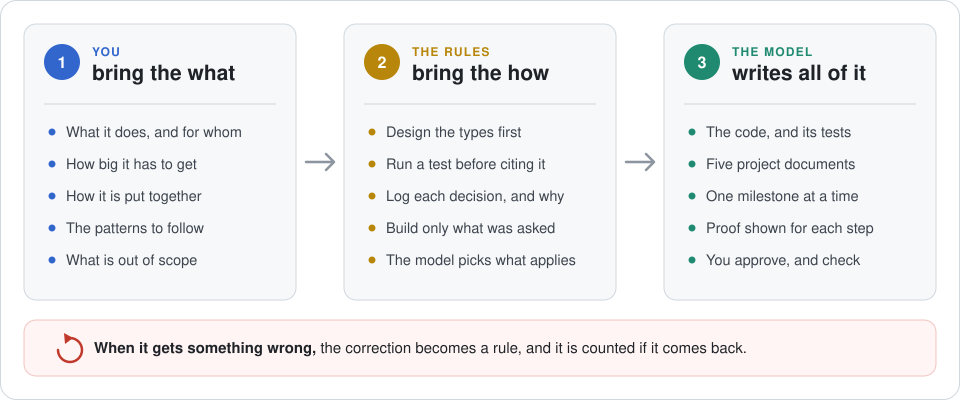
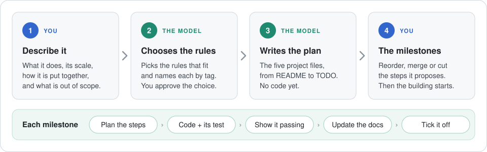
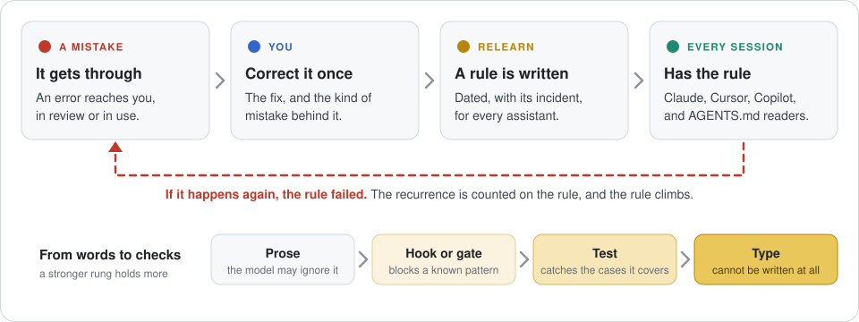

<div align="center">

# relearn

**Build software by describing it. You decide what gets built. The model writes every line.**

[](https://github.com/george-andrikopoulos/relearn/tags)
[](LICENSE)
[](Cargo.toml)
[](https://arxiv.org/abs/2608.19125)

[Your first project](#your-first-project-four-prompts) · [**The guide**](docs/adopting-relearn.md) · [Install](#install) · [When it gets it wrong](#when-the-model-gets-it-wrong) · [Under the hood](#under-the-hood) · [What was measured](#what-was-measured)

</div>

---

<p align="center">
  
</p>

An AI model already knows every way there is to build an orders API, a booking system or a data pipeline. What it does not know is **which one you want**. Left to guess, it guesses. It adds a cache nobody asked for, picks a database for you, and tells you the tests pass without running them.

So the job changes. You stop writing code and start writing the input:

- **What it does**, and for whom.
- **How big it has to get**: ten users or ten million, one server or many.
- **How it is put together**: the parts, and what talks to what.
- **The patterns it follows**: how errors are reported, how data is checked, how it is tested.
- **What is out of scope**, so nothing gets built that you did not ask for.

That is the architect's part, and it is the whole of your part. You don't need to know how to write the code. You need to know what you want, and to check that you got it.

The *how*, meaning the habits of good engineering, is already written down as **rules**. relearn installs them once on your machine. The model picks the ones that apply to your project and works under them. When it still gets something wrong, you correct it once, and the correction becomes one more rule.

## What you write, and what you don't

| You write | The model writes | The rules carry |
|---|---|---|
| a description of the project | all of the code | design the types before the code |
| answers to the model's questions | the tests that prove it works | run a test before saying it passes |
| yes, no, or "change this" on each plan | the five project documents | record every decision, and why |
| a correction, when something is wrong | a new rule, from your correction | build only what was asked for |

You never have to take the model's word for anything. Every step in [the guide](docs/adopting-relearn.md) ends with a **Check**, something you run or read yourself.

## Your first project: four prompts

<p align="center">
  
</p>

The first prompt is the one that matters. Fill in the brackets:

> I'm starting a new project. Don't create any files yet. Here is what it is:
> - **What it does:** [an HTTP API for orders: create, list and cancel, JSON over HTTPS]
> - **Stack:** [Rust, axum, PostgreSQL]
> - **Architecture:** [one service; handlers call a domain layer, which calls storage]
> - **Guidelines:** [every API error has the same shape; every endpoint has a test]
> - **Out of scope for now:** [logins, a user interface]
>
> Reply with what you understood, in five lines at most, then every decision I haven't made that you would have to make, as numbered questions.

A good answer is short, and full of questions: *which database driver? What does "cancel" mean once an order has shipped?* A bad answer is a finished design with logins, a cache and a message queue, none of which you asked for.

Answer the questions, and the next three prompts take you to an approved list of milestones. The model then builds them one at a time, and shows you each test running. [The guide](docs/adopting-relearn.md) has every prompt, what a good answer looks like, and how to check it.

**Already have a project?** Four different prompts have the model read the code and its history and write down what nobody did: how it is built, what it does today, what is still open, and why. Where it cannot find a reason, it writes *"not recorded"* and asks you, rather than inventing one. See [An existing project](docs/adopting-relearn.md#an-existing-project-four-prompts).

## Install

Once per machine, never per project:

```sh
cargo install --git https://github.com/george-andrikopoulos/relearn --locked
```

This needs [Rust](https://www.rust-lang.org/tools/install) and `git`. Then put the rule library where your assistant can reach it: [`claude-pack/`](claude-pack/README.md) for Claude Code and claude.ai, and [`rules-pack/`](rules-pack/README.md) for the language rules. Each pack's README has the steps.

From then on, every project you open has the whole library within reach. Nothing is copied into a project, except the rules that are particular to it.

## When the model gets it wrong

<p align="center">
  
</p>

A correction made in a chat dies with the chat, and the same kind of mistake comes back next week. In relearn a correction becomes a **rule**: one small file that says what went wrong, when, and what to do instead. relearn compiles it for every assistant you use: Claude, Cursor, GitHub Copilot, and anything that reads `AGENTS.md`.

A rule written in words can still be ignored. So when a mistake comes back, relearn counts it against the rule that should have stopped it, and tells you which rules keep failing. A rule that keeps failing should be turned into a check the model cannot get past: a hook, a gate, a test, or a type that makes the mistake impossible to write. The guide covers [each of these steps](docs/adopting-relearn.md#day-to-day-with-relearn).

## Under the hood

For engineers who want to know how relearn holds this together. The [manual](docs/manual.md) is the full reference.

A rule is one file in `rules/`, with front matter that must carry its provenance, and relearn writes it into each assistant's own format:

<table>
<tr>
<td width="50%" valign="top">

**You write** `rules/no-dbg-in-src.md`

```
+++
tag         = "R:no-dbg-in-src"
title       = "No dbg! in committed source"
error_class = "Debug output reaches users' stderr"
home        = { kind = "domain", name = "rust" }
created     = "2026-11-02"
origin      = "codified"
status      = { kind = "active" }
incident    = "dbg! prints in release builds too."
+++

Remove `dbg!` before committing; use a test
or a log line.
```

</td>
<td width="50%" valign="top">

**relearn writes**

| File | Read by |
|---|---|
| `skills/domain-rust/SKILL.md` | Claude |
| `.cursor/rules/no-dbg-in-src.mdc` | Cursor |
| `.github/copilot-instructions.md` | GitHub Copilot |
| `AGENTS.md` | any assistant that reads `AGENTS.md` |
| `.claude/rules/<home>.md` | Claude Code's rules layer (for project and user homes) |

Each output file is stamped with a hash and is never edited by hand. `relearn verify` fails if one drifts from its rule.

</td>
</tr>
</table>

- 🔁 **Recurrence is the metric.** When a rule's error class happens again, the rule failed, and the event is recorded on that rule. `lint` reports any rule that keeps failing while only prose holds it.
- 🪜 **Rules climb towards mechanical controls.** A rule's status records whether prose alone holds it, or a hook, test, gate or type holds part or all of it. A rule that is only partly held must name what is not held.
- 🪝 **Checks become hooks and gates.** A rule can carry a detector with fixtures. relearn compiles it into a Claude Code hook or a git gate, and proves it against its fixtures on every build.
- 📏 **Rules can be measured.** A probe replays a rule's error class in fresh sessions, with the rule loaded and without it, and reports the difference with its confidence interval ([what the first run found](#what-was-measured)).
- 🧾 **Provenance or it doesn't parse.** Every rule needs a date, an incident and the error class it is meant to prevent. A rule that fails to parse stops the build, because a silently skipped rule is a lost correction.
- 🏠 **One home per rule.** A rule has exactly one owner: `global`, a domain, an org or a project. A second copy is how a rule forks and goes stale, so relearn cannot represent one.
- 🔒 **Instruction files are checked like code.** `build` refuses to overwrite a file it did not write, and `verify` fails on any hand edit or drift.
- 👤 **Solo first.** No account, no config file, no network, no ambient state. Sharing between installs exists, and it is optional.

A rule's `status` records how far it has been pushed from words towards a check:

| Status | What holds the error class | In the emitted layer |
|---|---|---|
| `active` | prose alone | emitted |
| `partial` | a named control holds part of it, and `uncovered` names the rest | emitted, with "Partly enforced by …" |
| `graduated` | a named control holds all of it | emitted, with "Also enforced by …" |
| `attic` | retired | not emitted; kept so `lint` can flag references to it |

| Command | What it does |
|---|---|
| `new` · `check` · `list` | author a rule, validate the library, read the corpus as text or TSV |
| `build` · `verify` | compile to each target, and prove the committed output matches the rules |
| `lint` | advisory findings: overlaps, dangling references, unheld recurrences, graduation candidates |
| `controls` | resolve every control a rule names: does it exist, and does anything run it? |
| `budget` · `loads` | what a Claude Code session loads at start, and what it actually loaded over time |
| `probe` | judge sessions that replay a rule's error class, with the rule loaded and without it |
| `contribute` · `pull` · `adopt` · `report` · `aggregate` | optional sharing between installs through a common directory |

The repository also commits ready-to-install packs, each with its own README: [`claude-pack/`](claude-pack/) (skills, for Claude Code and claude.ai), [`copilot-pack/`](copilot-pack/), [`rules-pack/`](rules-pack/) (user-level Claude rules), [`hooks-pack/`](hooks-pack/) (Claude Code hooks), [`repo-pack/`](repo-pack/) (git gates) and [`load-log-pack/`](load-log-pack/) (the load-logging hook).

A real rule set lives in [`rules/`](rules/). It spans a global layer, language and discipline domains (`rust`, `java`, `low-latency`, `disclosure`, `agent-tooling`, `project-files`) and several project homes. Run `relearn check` for its current size. A count written here would go stale ([`R:doc-currency`](rules/doc-currency.md)).

Behind most corrections is a decision the assistant made for itself, on no evidence in the repository. Paper 3 calls these **invented requirements**. Their visible residue is **skedasis** (from σκεδάννυμι, to scatter): the fraction of a change that nobody requested. Skedasis is a ratio, not a size. Two hundred lines is not skedasis if the task needed two hundred. A written description, and a rule for each correction, are how an invented requirement is caught once instead of invented again every session.

### relearn and rulesync

[rulesync](https://github.com/dyoshikawa/rulesync) also compiles one set of rules into many assistants' formats, and it covers much more of each tool's configuration than relearn does. Besides rules, it handles commands, MCP servers, ignore files, subagents and skills, and it can import the configuration you already have. If you need one source for all of that, use rulesync.

relearn compiles to fewer targets, because the compiler is not the point. It is built around what happens to a rule after it is written: where it came from, what enforces it, whether it is still failing, and when it was retired, and why. If you have only a few rules and the model follows them, you probably do not need relearn.

## What was measured

Two kinds of evidence exist so far. Neither is an efficacy claim for the discipline as a whole, and **the four-prompt workflow above has not itself been measured.**

**Probes: the same task with the rule loaded and without it.** On 2026-10-31, seven rules were replayed on `claude-opus-5-5`. Each rule had ten sessions per arm, on a synthetic task built to provoke its error class: 140 sessions in all, costing $13.52.

One rule separated the arms. Without [`R:prefer-by-construction`](rules/prefer-by-construction.md), 9 of 9 sessions made the error. With it, 2 of 9 did, a reduction of 0.78 (95% CI 0.34 to 0.94). All six sessions that actually opened the rule held.

The other six rules gave no result:
- **Three:** the model did not make the error, with the rule or without it.
- **Two:** their probes were defective.
- **One:** no session opened the skill that carries the rule. That is a finding about how the rule is delivered, not about what it says.

The full table and the reading of each transcript are in [`docs/control-triage.md`](docs/control-triage.md#results-2026-10-31-the-first-pilot). This was one model, with small samples, on one author's rules. It shows that the instrument can separate the two arms, and that one rule changed what one model did on one task. It does not show that rules written this way work in general.

**Paper 3: repository history.** Paper 3 pre-registered its metrics and its falsification conditions before reading any commit history, and **its headline hypothesis was refuted.** Across nine of the author's repositories, the discipline leaves no mark on the size of a change: median lines added per code-changing commit fall in a common band whether a repository is governed or not. The paper puts this down to the instrument, since skedasis is a ratio and commit size measures only its numerator. Even so, the prediction failed, and the paper reports it as a failure. Capture of deferred work is the one metric that separated the two groups. The parking lot fires in a fifth to two-fifths of code-changing commits in governed repositories, and in under five per cent in ungoverned ones.

relearn is in the governed arm of that comparison. It is **excluded** from the paper's hand-coded study of invented requirements, because its sessions are mixed into one transcript store with hundreds of unrelated ones. **Nothing here should be read as an efficacy claim.** The discipline is implemented. The evidence from history is one refuted prediction, one correlational separation, and a single-author corpus that cannot establish causation either way.

To see one real incident become one rule and compile out to every layer, read [`docs/worked-example.md`](docs/worked-example.md). For the same rule passed between two installs, read [`docs/worked-example-two-installs.md`](docs/worked-example-two-installs.md).

## Contributing to this repository

This repository is **public**, and a rule's `incident` is a verbatim quotation from a private session. Arm the pre-push gate once per clone:

```sh
git config core.hooksPath .githooks
```

The gate runs `scripts/check.sh` and the banned-names scan. The scan reports a location and a count, never the term itself, and exits 2 rather than 0 when it has no term list. The list is deliberately not committed: it is read from `$BANNED_TERMS_FILE` or `~/.claude/usage/banned-terms.sha256`. Nothing in the repository can check that your clone did this, so run the line before your first push.

To learn how the code is built, read [`ARCHITECTURE.md`](ARCHITECTURE.md) for the pipeline and the decisions log, [`FEATURES.md`](FEATURES.md) for every guarantee and the artefact that enforces it, and [`CLAUDE.md`](CLAUDE.md) for the full recreation standard.

## Papers

relearn is the reference implementation of the error loop in a series of three papers by George Andrikopoulos (2026):

- **Tuning the Stochastic Machine** ([arXiv:2608.19125](https://arxiv.org/abs/2608.19125)): the operating discipline. relearn implements the Stochos framework's first two principles, *persist or perish* and *one home per rule*.
- **Grouping the Stochastic Machine** ([arXiv:2608.19140](https://arxiv.org/abs/2608.19140)): the precision-measurement companion. It uses this repository as its reference system.
- **Aiming the Stochastic Machine: A Repository Discipline for First-Time-Right, and What Survived Measuring It** ([doi:10.5281/zenodo.22083202](https://doi.org/10.5281/zenodo.22083202); study materials at [doi:10.5281/zenodo.22082967](https://doi.org/10.5281/zenodo.22082967)). It specifies the four-file repository discipline this repository is built on, and uses this repository as its worked case (§8), including a defect found here. Paper 3 is a Zenodo preprint: arXiv moderation declined it, and will consider an appeal only after journal publication.

## Licence

Apache-2.0, see [`LICENSE`](LICENSE). The explicit patent grant matters for anything an enterprise might adopt.

<sub>George Andrikopoulos · United Kingdom</sub>
